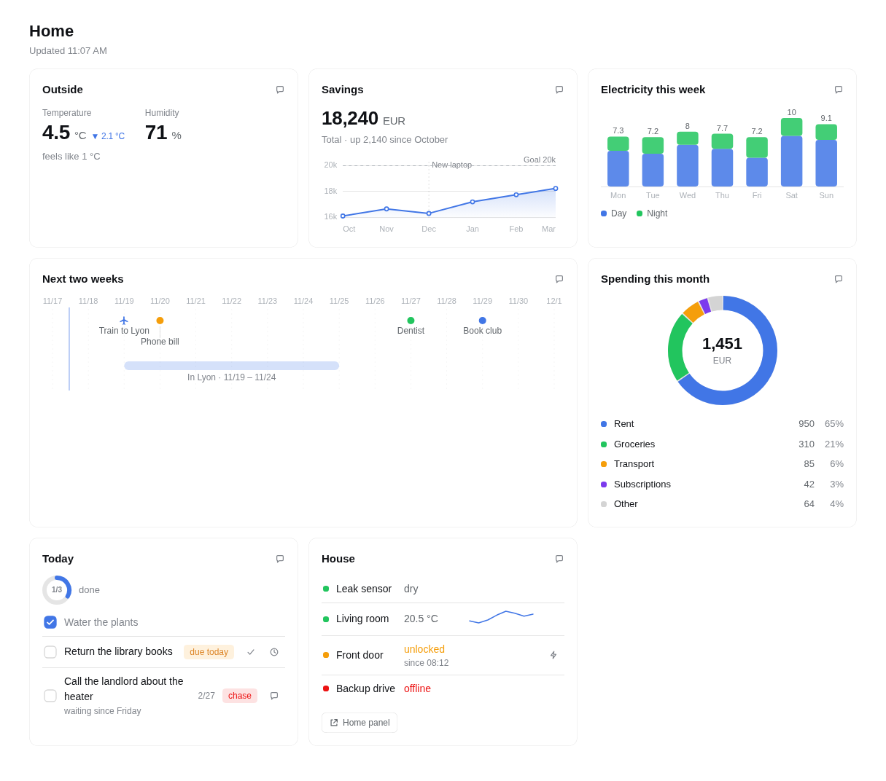

# dsh-card-board

A card board for the [DeepSeek Harness](https://github.com/deepseek-ai/dsh) Web UI. Your own scripts write small JSON files, one per card; the plugin shows them as a page of numbers, charts and lists, and each signed-in person sees only the boards they're allowed to.

The plugin only displays. It makes no outbound requests, holds no credentials and never runs anything, so keeping data fresh is up to whatever writes the files: a cron job, a watcher, a script on another machine that syncs the folder. There's no model in the loop and no cost per refresh.



## Install

```sh
npx @deepseek-ai/dsh plugin --profile web add @soffits/dsh-card-board@latest
```

Restart `dsh web` afterwards. It adds one Host row, `card-board`, and a **Boards** entry in the sidebar. Boards live in `card-board` under the DSH home unless you set `dataDir`.

## Configuration

Override the row in your profile's `cordis.patch.yml`:

```yaml
- id: card-board
  config:
    dataDir: ~/boards
    peopleFile: ~/people.json
    peopleKey: users
```

| Option | Default | What it does |
| --- | --- | --- |
| `dataDir` | `<DSH home>/card-board` | The folder with the boards. `~/` means the home folder. |
| `people` | `{}` | Verified user id → person id, for a DSH several people sign in to. |
| `peopleFile` | | A JSON file with more of that mapping, re-read when it changes. `people` wins on a clash. |
| `peopleKey` | | The key in `peopleFile` that holds the mapping; empty means the whole file. |
| `pollSeconds` | `30` | How often an open, visible page checks for changes. A hidden tab doesn't poll. |
| `actionLog` | `<dataDir>/.actions.jsonl` | Where action presses are appended. |
| `actionTimeoutSeconds` | `300` | A press nobody handles within this time shows as not handled. |

## Who sees what

With no `people` and no `peopleFile`, the plugin assumes a single-person DSH: everyone DSH lets in sees every board.

With a mapping, each request is checked on the server. The plugin asks the `requestIdentity` service who made the request, maps that user id to a person id, and serves only boards whose `viewers` list that person. A request without a verified identity sees no boards; a board the person may not see answers 403, the same as one that doesn't exist. The tabs in the page come only from the server's list. Person ids compare without regard to case.

`requestIdentity` is a small service any sign-in plugin can provide. [dsh-oidc](https://github.com/soffits/dsh-oidc) (0.3.0-alpha.9 or later) does; another plugin can provide the same interface:

```ts
interface RequestIdentityService {
  /** The verified person behind the /api request being handled, or null. */
  current(): { provider: string; issuer: string; id: string; name?: string } | null
}
```

The card board reads it with `ctx.get('requestIdentity')` at request time, so it doesn't depend on any one sign-in plugin. Deciding who a request is, including one that reaches DSH without passing the sign-in (a local port), is the provider's job; the board only maps the id it gets. With a mapping configured and no provider running, the board routes answer 503 rather than showing everything.

## Data layout

```
<dataDir>/
  <board>/
    board.json
    cards/<card>.json
```

Board and card ids are lowercase letters, digits, `-` and `_`, up to 64 characters.

`board.json`:

```json
{
  "title": "Home",
  "viewers": ["alex", "sam"],
  "order": ["weather", "savings", "energy"],
  "layout": { "next-weeks": { "w": 2, "h": 1 } },
  "assistant": "Robin"
}
```

`order` lists cards to put first; the rest follow by id. `layout` sets a card's width and height in grid cells (1 to 3). The grid has four columns on a very wide screen, three on a wide one, two on a medium one and one on a phone; a wide card shrinks to fit. `assistant` is optional: the name the chat buttons ask ("Ask Robin" instead of "Ask"). `title` can be [text in several languages](#languages).

A card:

```json
{
  "type": "stat",
  "title": "Outside",
  "updatedAt": "2026-03-02T09:30:00Z",
  "staleAfter": 3600,
  "link": "https://example.com/weather",
  "data": { "items": [{ "label": "Temperature", "value": 4.5, "unit": "°C" }] }
}
```

| Field | |
| --- | --- |
| `type` | `stat`, `line`, `bar`, `donut`, `list`, `timeline` or `status` |
| `title` | Shown on the card. |
| `updatedAt` | ISO date-time with a zone. The CLI fills it in when you leave it out. |
| `staleAfter` | Seconds. Past this the card is dimmed and says how old it is. |
| `link` | An `http(s)` URL or a `/path` the title row links to. |
| `stat` | A headline above a chart: the same shape as a `stat` card's `data`. |
| `actions` | Buttons on the card; see [Actions](#actions). |
| `data` | Depends on the type, below. |

Unknown fields are errors, so a typo fails when the file is written instead of quietly not showing. A card that doesn't parse or fails the schema shows as a small error card with the reason; the rest of the board is unaffected.

Colours are never given directly. `tone` is one of `ok`, `warn`, `bad`, `muted` or `accent`, and the page maps it to DSH's theme, light or dark. Dates are `YYYY-MM-DD` or ISO date-times. Numbers, dates and units are formatted by the page in the viewer's language.

### Languages

Every text a person reads (titles, labels, units, sub-lines, chip text, list rows, point and span labels, a status row's value, action labels) is either a string, shown as it is to everyone, or a map from language id to text:

```json
"title": { "en": "Today", "fr": "Aujourd’hui", "zh": "今天" }
```

Ids are lowercase BCP 47 tags and `en` is required, the same shape DSH uses for localized package text. The page shows the text for DSH's active language: the exact tag (`pt-br`), then its primary language (`pt`), then `en`. So one board reads in French to one person and in Chinese to another, and the file holds no preference of its own. Things that are data, not words (a to-do's title, a merchant), stay plain strings. Bar series names (the keys of `values`) and x values are not translated.

The page's own words (buttons, empty states, errors) live in [`locale/<tag>.json`](locale), under `ui`, one file per language. English, French and Chinese ship. Which languages exist is whatever files are there: a new language is one new file with the same keys as `en.json`, no code change (a test checks every file has every key and the same `{placeholders}`), and a missing key falls back to the primary language, then English.

### stat

One to six big numbers.

```json
{ "items": [
  { "label": "Temperature", "value": 4.5, "unit": "°C", "delta": { "value": -2.1, "unit": "°C", "tone": "accent" }, "sub": "feels like 1 °C" },
  { "label": "Humidity", "value": 71, "unit": "%" }
] }
```

`value` is a number or a string (for numbers you've already formatted). `tone` on an item colours its value.

### line

```json
{
  "series": [{ "name": "Savings", "points": [{ "x": "2025-10-01", "y": 16100 }, { "x": "2026-03-01", "y": 18240 }] }],
  "unit": "EUR",
  "area": true,
  "goal": { "label": "Goal 20k", "y": 20000 },
  "markers": [{ "x": "2025-12-01", "label": "New laptop" }]
}
```

`x` is a date, a number or a label; dates are spaced by time. `y` may be `null` for a gap. A goal is a flat `y` or its own `points` (a rising target, say). Up to six series, each with an optional `tone`.

### bar

```json
{
  "bars": [{ "x": "Mon", "values": { "Day": 5.2, "Night": 2.1 } }, { "x": "Tue", "values": { "Day": 4.8, "Night": 2.4 } }],
  "stacked": true,
  "unit": "kWh",
  "goal": { "label": "Target", "y": 8 }
}
```

Each bar has a single `value` or named `values`; with `values` and no `stacked`, the series stand side by side.

### donut

```json
{
  "segments": [{ "label": "Rent", "value": 950 }, { "label": "Groceries", "value": 310 }, { "label": "Other", "value": 64, "tone": "muted" }],
  "centre": { "text": "1,324", "sub": "EUR" },
  "unit": "EUR"
}
```

### list

```json
{
  "progress": { "done": 1, "total": 3, "label": "done" },
  "rows": [
    { "title": "Water the plants", "checked": true },
    { "title": "Return the library books", "checked": false, "chip": { "text": "due today", "tone": "warn" } },
    { "title": "Call the landlord", "sub": "waiting since Friday", "date": "2026-02-27" }
  ],
  "empty": "Nothing left for today."
}
```

`checked` draws a checkbox (display only). `progress` draws a ring beside the rows.

### timeline

```json
{
  "from": "2026-03-02",
  "to": "2026-03-16",
  "points": [{ "date": "2026-03-04", "label": "Train to Lyon", "kind": "travel" }, { "date": "2026-03-05", "label": "Phone bill", "kind": "due" }],
  "spans": [{ "from": "2026-03-04", "to": "2026-03-09", "label": "In Lyon" }]
}
```

`kind` is `travel` (drawn as a plane), `due`, `event`, `health`, `home` or `money`; each has a default tone, and `tone` overrides it. Today gets a thin line.

### status

```json
{ "rows": [
  { "label": "Leak sensor", "value": "dry", "tone": "ok" },
  { "label": "Living room", "value": "20.5 °C", "tone": "ok", "spark": [19.8, 19.6, 20.4, 20.8, 20.5] },
  { "label": "Front door", "value": "unlocked", "tone": "warn", "sub": "since 08:12" }
] }
```

`spark` draws a small line beside the value.

The [examples](examples/boards/home) folder has a complete board with one card of each type.

## Actions

A card, a list row or a status row can carry up to six buttons:

```json
"actions": [
  { "kind": "done", "id": "library-books:done" },
  { "kind": "snooze", "id": "library-books:snooze" },
  { "kind": "chat", "id": "landlord:ask", "label": "Draft a message", "payload": { "prompt": "Help me write a short follow-up to the landlord." } },
  { "kind": "event", "id": "front-door:lock", "label": "Lock" },
  { "kind": "link", "id": "panel", "label": "Home panel", "payload": { "url": "https://example.com/home" } }
]
```

- `chat` opens a new conversation (or the session named in `payload.session`) with a draft that quotes the card or row and carries its ids as JSON, after `payload.prompt` if you gave one. Nothing is sent until the person sends it, so the message comes from them like any other. Every card also has a chat button in its corner without declaring one; when the board names an `assistant` the button says who it asks. A `label` can be text in several languages.
- `done`, `snooze` and `event` are pressed on the server. A snooze without `payload.until` asks: in 3 hours, tomorrow at 9:00, or a time.
- `link` opens `payload.url`.

`id` is yours: letters, digits and `. _ : -`, unique within the card or row. `label` is optional except for `event`. `payload` is any small object (up to 4 KB of JSON).

The plugin doesn't act on a press itself. It checks that the person may see the board and that the action is in the card as written, then records an event:

```json
{
  "press": "fcb114dd-3890-42e6-af4b-b23173edf8e0",
  "action": "done",
  "id": "library-books:done",
  "payload": {},
  "person": "alex",
  "user": "<verified user id>",
  "at": "2026-03-02T09:41:12.000Z",
  "source": { "plugin": "dsh-card-board", "board": "home", "card": "chores", "row": 1 }
}
```

It's appended to the action log, emitted in-process as the Cordis event `card-board/action`, and published on channel `ui.action.<kind>` through [dsh-cron-jobs](https://github.com/soffits/dsh-cron-jobs) when that's installed, so a job subscribed to `ui.action.done` can mark the thing done wherever it lives. `person` is `owner` on a single-person DSH.

The button shows the press as pending until the card file is written again, then done. If nothing rewrites the card within `actionTimeoutSeconds`, it says nothing picked the press up. So a handler should rewrite the card when it has acted, even if only `updatedAt` changes.

The buttons come from [`client.actions.js`](client.actions.js), loaded with the page. On a phone they are at least 40 px, and a snooze picker opens as a sheet at the bottom of the screen.

## Writing cards: the CLI

`dsh-card-board` validates a card and writes it atomically (a temporary file, then a rename), so the page never reads half a file and bad data fails at write time:

```sh
export CARD_BOARD_DIR=~/boards
dsh-card-board board home board.json          # write home/board.json
echo '{"type":"stat","title":"Outside","data":{"items":[{"label":"Now","value":4.5,"unit":"°C"}]}}' \
  | dsh-card-board put home weather            # write home/cards/weather.json
dsh-card-board rm home weather
dsh-card-board check card.json                 # validate only
dsh-card-board check --board board.json
dsh-card-board check --dir ~/boards            # everything under a data folder
```

Input comes from the file argument, or stdin when it's `-` or left out. `--dir` overrides `CARD_BOARD_DIR`. An invalid card exits with status 1 and prints each problem with its path (`data.rows[0].title: is required`); usage errors exit with 2.

From JavaScript the same checks are `import { checkCard, checkBoard } from '@soffits/dsh-card-board/schema'`.

## How the page updates

The page polls `GET /api/card-board/board?id=<board>` while it's visible, with the last `ETag` in `If-None-Match`. The tag is built from file sizes and times, so an unchanged board answers 304 without reading a card. Coming back to the tab checks at once. The page's words come once per language from `GET /api/card-board/locale?tag=<id>` (the merged `locale/*.json`, English filling gaps).

## Development

```sh
npm install
npm run check   # syntax of every file, and the example board against the schema
npm test        # node --test, including a run behind DSH's real Connection
```

## License

MIT
